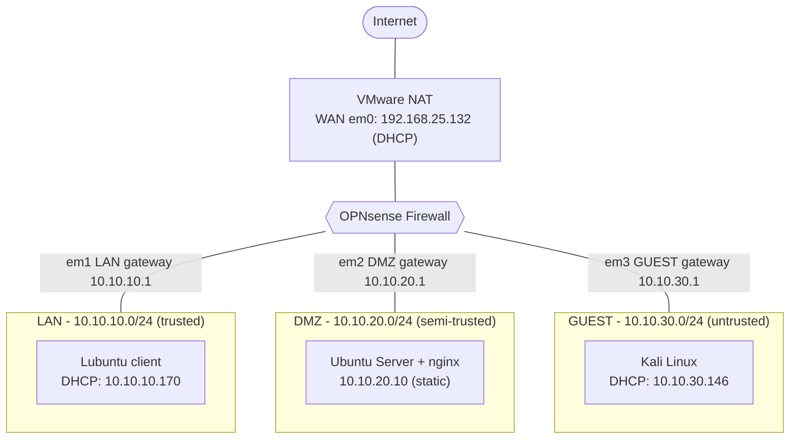
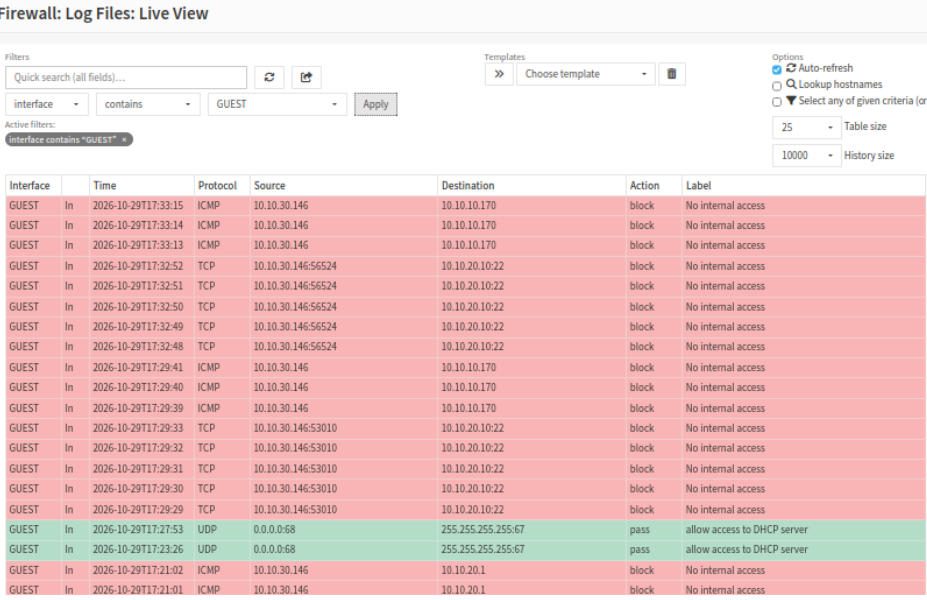
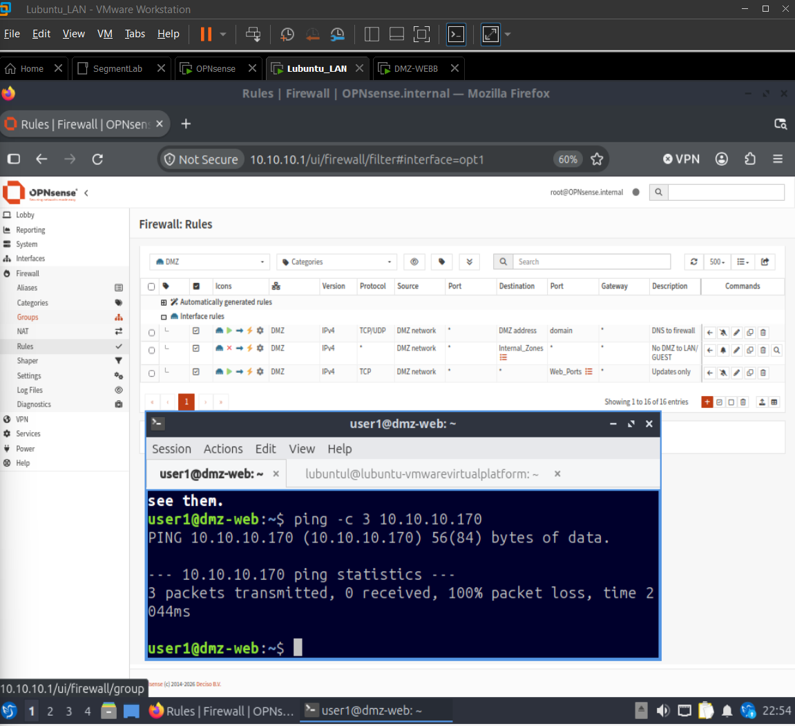
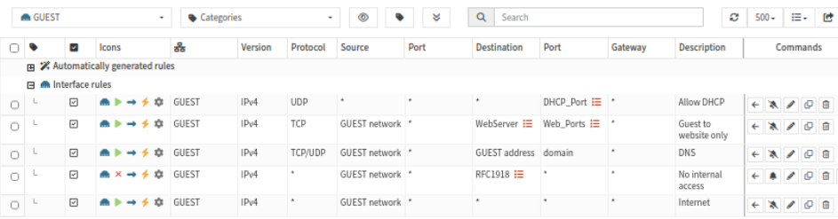
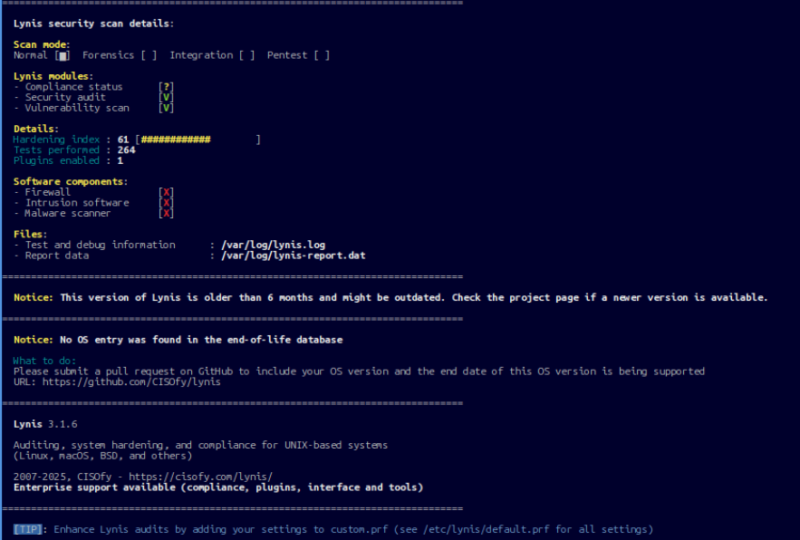
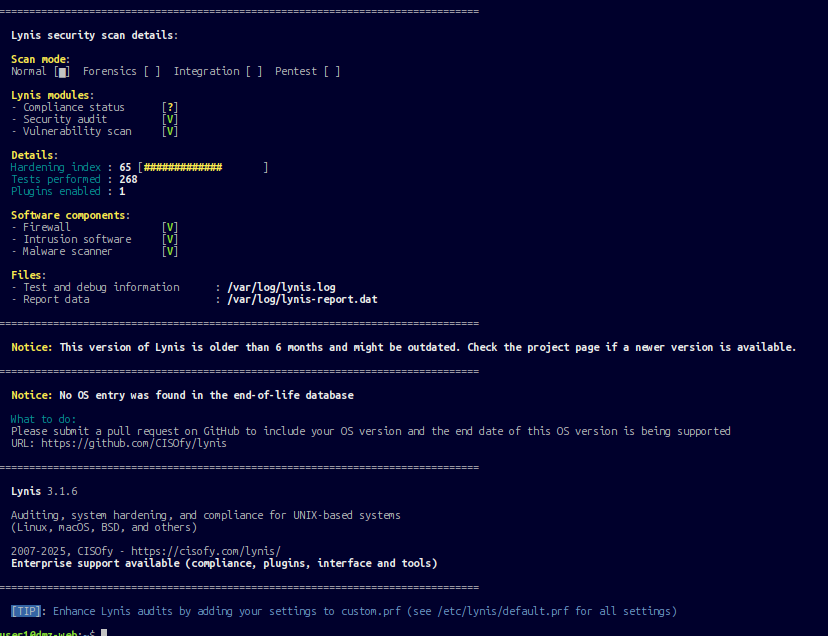
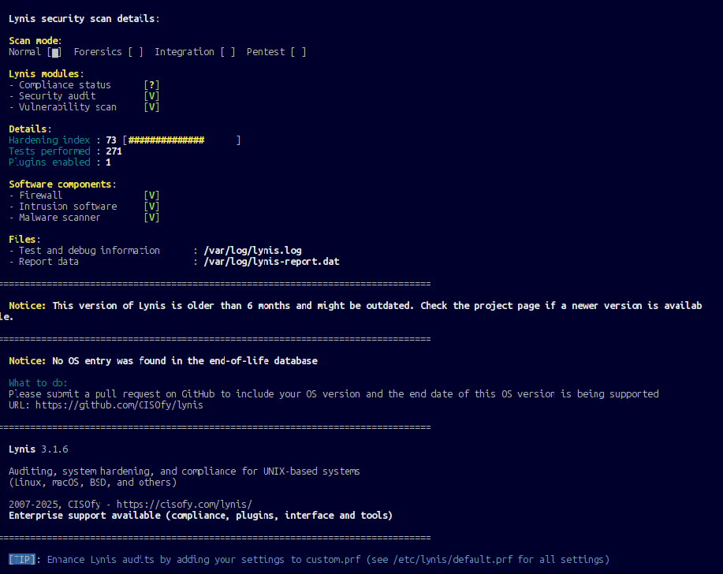

# Three-Zone Fortress: A Network Segmentation and Hardening Lab

*Three zones, one firewall, and every crossing between them is a rule I can explain.*

**OPNsense firewall · LAN / DMZ / GUEST segmentation · hardened web server · evidence-based testing**

A home lab that builds a small company network inside VMware Workstation. One OPNsense firewall splits the network into **LAN**, **DMZ** and **GUEST** zones. A Linux web server sits in the DMZ, an attacker machine (Kali) sits in GUEST, and every allowed or blocked path is written down, tested and backed by log evidence. The web server is then hardened with Lynis, and the score is measured before and after.

**Built:** October 2026 · **Hypervisor:** VMware Workstation Pro · **Firewall:** OPNsense 26.7

## Results at a glance

| Goal | Result |
|---|---|
| Kali (untrusted) can load the DMZ website | Pass, `HTTP/1.1 200 OK` from nginx |
| Kali cannot SSH to the web server or reach the LAN | Pass, blocked and logged by rule "No internal access" |
| A compromised web server cannot move into the LAN | Pass, DMZ to LAN ping shows 100% loss, logged by rule "No DMZ to LAN/GUEST" |
| LAN can still administer the DMZ over SSH | Pass |
| Web server hardening (Lynis hardening index) | **61 to 73** |

Full tables and evidence: [firewall rules](docs/03-firewall-rules.md) · [test results](docs/04-test-results.md) · [hardening](docs/05-hardening-lynis.md).

## Architecture

Each zone is a separate VMware LAN Segment, which acts as an isolated virtual switch. OPNsense has one virtual network card on each, so every packet between zones must pass through its rule set.



This is a **three-legged (single-firewall) DMZ**. A production network handling sensitive data would usually put the DMZ between two firewalls, so one compromised firewall does not expose every zone. See [architecture notes](docs/01-architecture.md).

### IP plan

| Zone | Network | Firewall address | Hosts |
|---|---|---|---|
| WAN | VMware NAT (`192.168.25.0/24`) | `192.168.25.132` (DHCP) | Internet via the host |
| LAN | `10.10.10.0/24` | `10.10.10.1` | Lubuntu `10.10.10.170` (DHCP pool `.100` to `.200`) |
| DMZ | `10.10.20.0/24` | `10.10.20.1` | Web server `10.10.20.10` (static) |
| GUEST | `10.10.30.0/24` | `10.10.30.1` | Kali `10.10.30.146` (DHCP pool `.100` to `.200`) |

### Virtual machines

| VM | Role | Segment | RAM | Disk |
|---|---|---|---|---|
| OPNsense 26.7 | Firewall, router, DHCP | NAT + LAN + DMZ + GUEST | 2 GB (4 vCPU) | 10 GB |
| Lubuntu | LAN client, firewall management | LAN | 3 GB | 25 GB |
| Ubuntu Server + nginx | DMZ web server | DMZ | 2 GB | 15 GB |
| Kali Linux | Attacker | GUEST | 4 GB | 25 GB |

*Sizes for Lubuntu, the web server and Kali are the build-plan values. The OPNsense VM values are from its VMware configuration.*

## Firewall policy in one table

| From | To | Allowed |
|---|---|---|
| LAN | anywhere | Everything (default OPNsense LAN rule) |
| DMZ | firewall | DNS only |
| DMZ | LAN, GUEST | **Blocked and logged** |
| DMZ | internet | Ports 80 and 443 (updates) |
| GUEST | web server `10.10.20.10` | Ports 80 and 443 only (logged) |
| GUEST | firewall | DNS only |
| GUEST | any private address (LAN, rest of DMZ, firewall, VMware NAT) | **Blocked and logged** |
| GUEST | internet | Allowed |

Rules are evaluated per interface, top to bottom, first match wins, and anything unmatched is denied. Each rule and the reason it exists is in [docs/03-firewall-rules.md](docs/03-firewall-rules.md).

## Evidence

**Traffic stopped by my own rules.** Kali's attempts to reach the LAN and SSH to the web server, blocked and logged:



**A compromised web server cannot reach the LAN.** Ping from the DMZ server to the LAN host, with the DMZ rule list:



**GUEST rule set:**



**Hardening: Lynis 61 to 73:**

| Before (61) | After tools (65) | After configuration (73) |
|---|---|---|
|  |  |  |

All 19 screenshots are in [`screenshots/`](screenshots/) and are referenced from the docs.

## What went wrong and what I learned

Most of the learning came from things that broke. The full write-ups are in [docs/06-troubleshooting.md](docs/06-troubleshooting.md).

- **Kali got no IP address.** The DHCP range for GUEST existed, but the Dnsmasq service was only listening on the LAN interface. A range defines *what* to hand out, and the interface list defines *where*. I had first added a manual "allow DHCP" rule on GUEST. It turned out to be unnecessary, because OPNsense generates its own DHCP rules once the service listens on the interface, so I removed it.
- **`apt` failed on the DMZ server.** OPNsense denies everything on an interface that has no rules, so the server could not even resolve DNS. I used a temporary allow-all rule to install nginx, then replaced it with the real rule set before running any tests. Testing with the temporary rule in place would have made the results meaningless.
- **Config typos at a console without copy and paste.** A swapped `network:` key and a stray period broke the netplan file. I fixed it by reading `netplan apply`'s error position, then moved to SSH from the LAN client so I could paste commands.
- **A package that did not exist.** `apt-listbugs` has no candidate in this Ubuntu release, which aborted the whole install command. Dropping it and rerunning fixed it.

## Limitations

- Single-firewall DMZ, so OPNsense itself is a single point of failure.
- Lynis 3.1.6 was used for both scans so the scores are comparable. A newer Lynis has more tests, so its scores are not directly comparable.
- Not done here: HTTPS on nginx (the DMZ rule already permits port 443), IDS/IPS on OPNsense, and central logging. A follow-up project adds a SIEM.
- Lab only. Credentials in the exported configuration are redacted.

## Repository layout

```
.
├── README.md
├── docs/
│   ├── 01-architecture.md       Design, IP plan, DMZ model
│   ├── 02-build-log.md          Step-by-step build with commands and screenshots
│   ├── 03-firewall-rules.md     Every rule and the reason it exists
│   ├── 04-test-results.md       Test table with evidence
│   ├── 05-hardening-lynis.md    Lynis before and after, fixes applied and skipped
│   └── 06-troubleshooting.md    Problems, causes and fixes
├── configs/
│   ├── opnsense/config-redacted.xml   Sanitized firewall export
│   └── web-server/                    netplan, sysctl, modprobe, hardening script
└── screenshots/                 NN-description.png evidence
```

## Skills demonstrated

Network segmentation and DMZ design · stateful firewall rule design and ordering · DHCP, DNS and NAT · firewall logging and evidence-based testing · Linux server hardening (UFW, fail2ban, rkhunter, auditd, sysctl, PAM) · security auditing with Lynis · documentation of failures and fixes.
