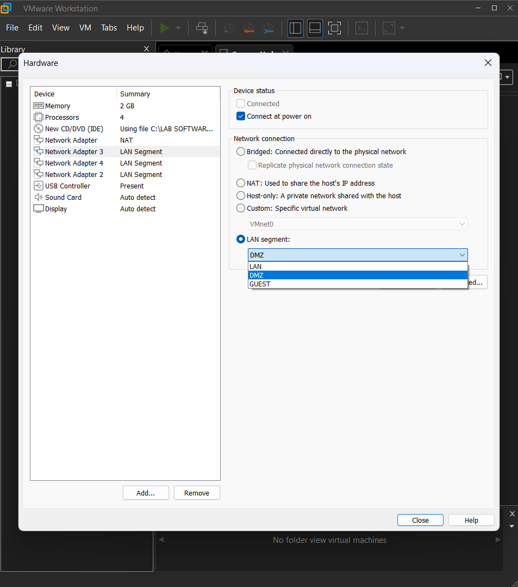
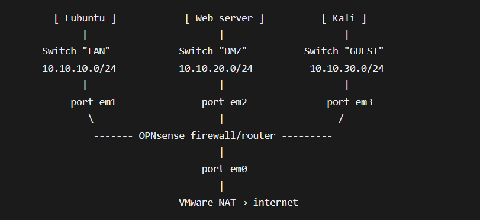

# 01. Architecture

## Goal

Build a segmented network where an untrusted outsider can reach one public service and nothing else, and where a compromised public server cannot reach the trusted network.

## Components

- **OPNsense** is the router, stateful firewall and DHCP server. It is a FreeBSD-based operating system running in its own VM.
- **VMware LAN Segments** (`LAN`, `DMZ`, `GUEST`) are isolated virtual switches. They are invisible to the host PC and to the home network, and VMware's own DHCP never touches them, so OPNsense hands out the addresses.
- **VMware NAT** provides the internet path. OPNsense's WAN port is a DHCP client on it.

## Interfaces

| Port | OPNsense role | VMware network | Address |
|---|---|---|---|
| em0 | WAN | NAT | `192.168.25.132/24` (DHCP, gateway `192.168.25.2`) |
| em1 | LAN | LAN Segment `LAN` | `10.10.10.1/24` |
| em2 | DMZ (opt1) | LAN Segment `DMZ` | `10.10.20.1/24` |
| em3 | GUEST (opt2) | LAN Segment `GUEST` | `10.10.30.1/24` |

Two settings are easy to confuse. The **segment name** (set in VMware) decides which virtual switch an adapter is plugged into. The **role** (set in OPNsense) decides what the firewall treats that port as. They are linked by matching each adapter's MAC address to its interface name (`em0` to `em3`).

## Why a DMZ

A public-facing server is the machine most likely to be attacked. Putting it in its own zone means a successful attack on it does not give the attacker a route into the internal network, because the DMZ's rules block traffic toward the LAN.

## DMZ model used

This lab uses a **three-legged DMZ**: one firewall with a separate port for each zone.

| | Single firewall (this lab) | Dual firewall (back-to-back) |
|---|---|---|
| Layout | One firewall, a port per zone | Internet, firewall 1, DMZ, firewall 2, LAN |
| Cost and complexity | Lower | Higher |
| Weakness | One compromised firewall exposes every zone | Attacker must defeat two firewalls |
| Typical use | Small and mid-size networks, labs | Large or high-security environments |

## Network diagram

The Mermaid version is in the [README](../README.md#architecture).
