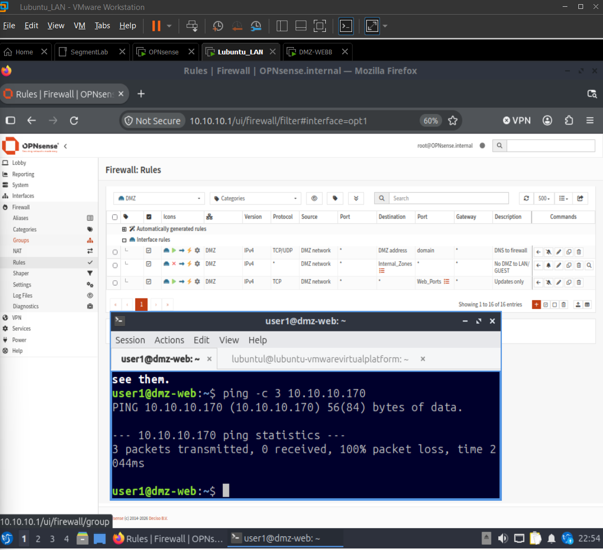
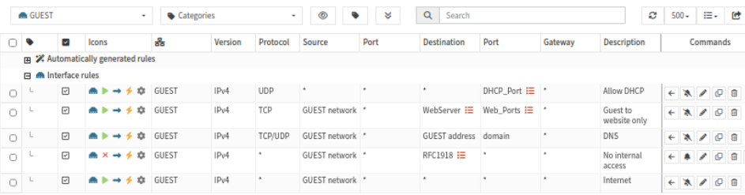

# 03. Firewall rules

Exported rule set: [`configs/opnsense/config-redacted.xml`](../configs/opnsense/config-redacted.xml).

## How the rules work

1. Rules attach to an **interface** and are checked against traffic **arriving** on it (direction `in`).
2. They are evaluated **top to bottom**, and the **first match wins**.
3. Traffic that matches no rule is **denied**.
4. The firewall is **stateful**. When a connection is allowed in one direction, its replies are allowed back automatically. This is why the LAN can open an SSH session to the DMZ without any DMZ rule for it.

## Aliases

| Alias | Type | Content | Used for |
|---|---|---|---|
| `Internal_Zones` | Network | `10.10.10.0/24`, `10.10.30.0/24` | DMZ block rule (the LAN and GUEST networks) |
| `Web_Ports` | Port | `80`, `443` | Web traffic only |
| `WebServer` | Host | `10.10.20.10` | The DMZ web server |
| `RFC1918` | Network | `10.0.0.0/8`, `172.16.0.0/12`, `192.168.0.0/16` | All private addresses |

Aliases keep the rules readable and mean a change is made in one place.

## LAN (interface `em1`)

| # | Action | Source | Destination | Reason |
|---|---|---|---|---|
| 1 | Pass | LAN net | any | OPNsense default. The LAN is the trusted zone, so it can reach everything, including the DMZ for administration |
| 2 | Pass | LAN net (IPv6) | any | OPNsense default for IPv6 |

## DMZ (interface `em2`)

Order matters. The block sits above the general web rule.

| # | Action | Protocol | Source | Destination | Port | Log | Reason |
|---|---|---|---|---|---|---|---|
| 1 | Pass | TCP/UDP | DMZ net | DMZ address (`10.10.20.1`) | 53 | no | The server's DNS server is the firewall. Without this, name lookups fail and updates cannot work |
| 2 | **Block** | any | DMZ net | `Internal_Zones` | any | **yes** | A compromised web server must not reach the LAN or GUEST. This is the main security control of the DMZ |
| 3 | Pass | TCP | DMZ net | any | `Web_Ports` | no | The server can download updates over HTTP and HTTPS and nothing else |

**Why rule 2 sits above rule 3:** rule 3 allows web traffic to *any* destination, which includes the LAN. If it came first, the LAN would be reachable on ports 80 and 443. The block must match first.

## GUEST (interface `em3`)

| # | Action | Protocol | Source | Destination | Port | Log | Reason |
|---|---|---|---|---|---|---|---|
| 1 | Pass | TCP | GUEST net | `WebServer` | `Web_Ports` | yes | Guests may load the public website and nothing else on the DMZ |
| 2 | Pass | TCP/UDP | GUEST net | GUEST address (`10.10.30.1`) | 53 | no | DNS from the firewall |
| 3 | **Block** | any | GUEST net | `RFC1918` | any | **yes** | No access to any internal address (LAN, the rest of the DMZ, the firewall, the VMware NAT network) |
| 4 | Pass | any | GUEST net | any | any | no | Internet access. Everything private was already blocked above, so what remains is the public internet |

**Why the order works:** rule 1 lets the website through before rule 3 blocks the whole private range, which includes the DMZ. Rule 3 blocks every other private destination. Rule 4 then allows what is left.

## DHCP

DHCP is served by **Dnsmasq** on the LAN and GUEST interfaces only (ranges `.100` to `.200` on each). The DMZ has no DHCP because its server uses a static address.

OPNsense generates its own pass rules for DHCP when the service is enabled on an interface ("allow access to DHCP server"), so no manual DHCP rule is needed. An early manual rule was removed after this was found. See [troubleshooting](06-troubleshooting.md#kali-gets-no-ip-address).

## Logging policy

Logging is on for the rules that matter as evidence: the DMZ block, the GUEST block and the GUEST website rule. The internet rule and DNS rules are not logged, because they would flood the log.
