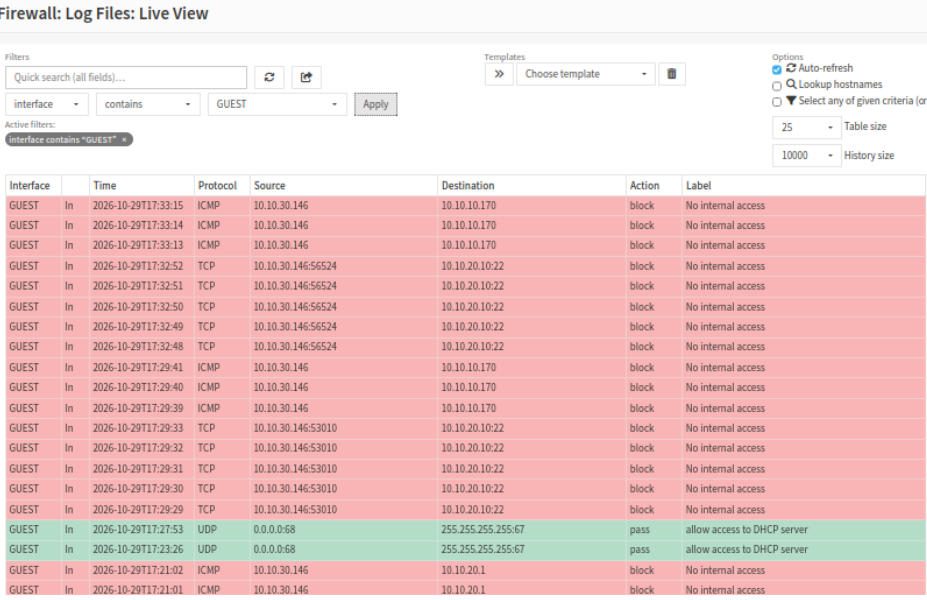
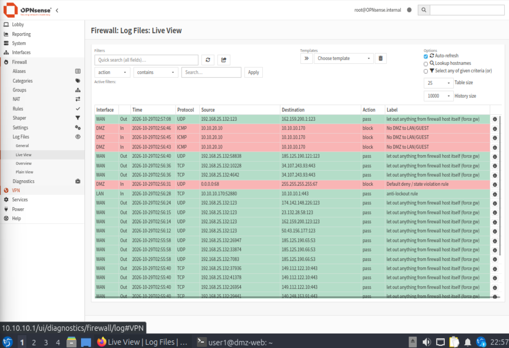

# 04. Test results

Each test names the machine it runs from, the command, what the policy says should happen, and what happened. Tests ran after the temporary allow-all rule was removed and the final rule set was in place.

| # | From | Test | Command | Expected | Result | Evidence |
|---|---|---|---|---|---|---|
| 1 | Kali (GUEST) | Reach the website | `curl -I http://10.10.20.10` | `200 OK` | **Pass**. `HTTP/1.1 200 OK`, `Server: nginx/1.30.4 (Ubuntu)` | [16](../screenshots/16-kali-curl-tests.png) |
| 2 | Kali (GUEST) | SSH to the web server | `ssh -o ConnectTimeout=5 user1@10.10.20.10` | Blocked | **Pass**. TCP port 22 to `10.10.20.10` blocked, label "No internal access" | [15](../screenshots/15-firewall-log-guest-blocks.png) |
| 3 | Kali (GUEST) | Reach a LAN host | `ping -c 3 10.10.10.170` | Blocked | **Pass**. ICMP to `10.10.10.170` blocked, label "No internal access" | [15](../screenshots/15-firewall-log-guest-blocks.png) |
| 4 | Kali (GUEST) | Reach the internet | `curl -I https://example.com` | `200` or `301` | **Pass**. `HTTP/2 200` | [16](../screenshots/16-kali-curl-tests.png) |
| 5 | Web server (DMZ) | Reach a LAN host | `ping -c 3 10.10.10.170` | Blocked | **Pass**. 3 sent, 0 received, 100% loss, logged as "No DMZ to LAN/GUEST" | [09](../screenshots/09-dmz-rules-and-blocked-ping.png), [10](../screenshots/10-firewall-log-dmz-block.png) |
| 6 | Web server (DMZ) | Package updates | `sudo apt update` | Works | **Pass**. All sources reachable | [08](../screenshots/08-dmz-apt-update-ok.png) |
| 7 | LAN client | SSH to the web server | `ssh user1@10.10.20.10` | Works | **Pass**. The Lubuntu session to `user1@dmz-web` is visible in screenshot 09 | [09](../screenshots/09-dmz-rules-and-blocked-ping.png) |
| 8 | LAN client | Gets an address from OPNsense DHCP | `ip a` | `10.10.10.100` to `.200` | **Pass**. `10.10.10.170` | [06](../screenshots/06-lubuntu-dhcp-lease.png) |
| 9 | Kali (GUEST) | Gets an address from OPNsense DHCP | `ip a` | `10.10.30.100` to `.200` | **Pass**. `10.10.30.146` (after the Dnsmasq fix) | [13](../screenshots/13-kali-dhcp-lease.png) |

## Reading the logs

The log label shows **which rule** stopped the traffic. In the DMZ, an early block was labeled "Default deny", which only proves that nothing allowed it. After the explicit block rules were added with logging, the entries carry the rule's own name ("No DMZ to LAN/GUEST", "No internal access"). That is the stronger evidence, because it shows the control is doing the job on purpose.

## Evidence still to add

Tests 2 and 3 are proven by the firewall log. A screenshot of the Kali terminal showing the SSH timeout and the 100% ping loss would make them easier to read at a glance. If you add them, save them as `20-kali-ssh-timeout.png` and `21-kali-ping-lan-blocked.png`, and link them in the table above.
