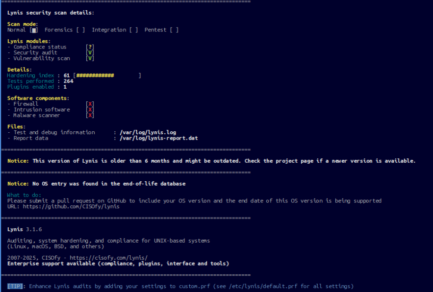
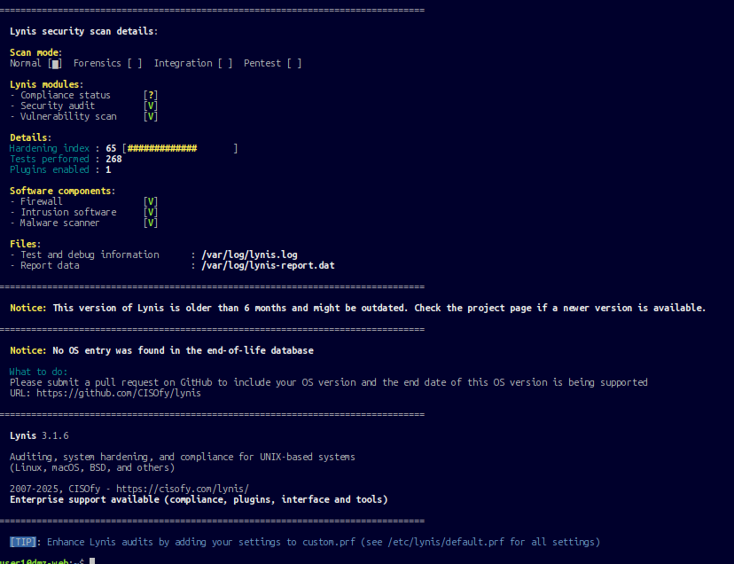
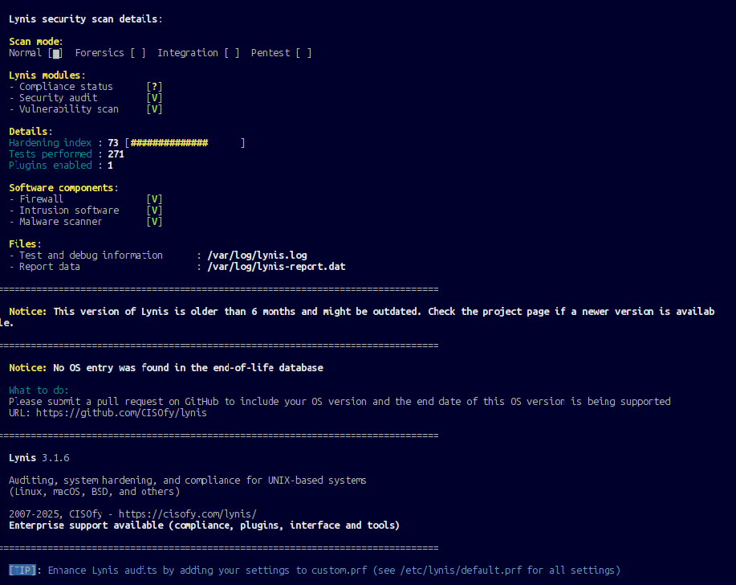

# 05. Hardening the web server with Lynis

**Target:** the DMZ web server (`dmz-web`, Ubuntu Server with nginx).
**Tool:** Lynis 3.1.6, used for every scan so the scores are comparable. Newer Lynis versions add tests, so their scores should not be compared with these.
**Command:** `sudo lynis audit system --quick`

## Scores

| Scan | Hardening index | Tests | Firewall | Intrusion software | Malware scanner |
|---|---|---|---|---|---|
| Baseline | **61** | 264 | no | no | no |
| After UFW, fail2ban, rkhunter | **65** | 268 | yes | yes | yes |
| After configuration hardening | **73** | 271 | yes | yes | yes |

| Before (61) | After tools (65) | After configuration (73) |
|---|---|---|
|  |  |  |

The three security tools raised the score by only 4 points, even though they turned all three software-component checks green. Most of the later gain came from configuration: password policy, kernel network settings, unused protocols and auditing.

## What was changed

All commands are in [`configs/web-server/harden.sh`](../configs/web-server/harden.sh).

**1. Updates**
```bash
sudo apt upgrade -y
```

**2. Host firewall (UFW).** Default deny inbound. SSH allowed only from the LAN, and HTTP for the website. The SSH rule was added before enabling UFW so the management session would survive.
```bash
sudo ufw default deny incoming
sudo ufw allow from 10.10.10.0/24 to any port 22 proto tcp
sudo ufw allow 80/tcp
sudo ufw enable
```
This is a second layer behind the network firewall: even if a DMZ rule were wrong, the server itself refuses SSH from anywhere outside the LAN.

**3. Intrusion and malware tooling**
- **fail2ban** bans an IP after repeated failed SSH logins. The default config was copied to `jail.local` so package updates cannot overwrite changes.
- **rkhunter** scans for rootkits, backdoors and modified system binaries.

**4. Security packages:** `libpam-tmpdir` (per-user temp directories), `libpam-pwquality` (password strength), `auditd` (login, file and privilege auditing), `acct` (process accounting), `debsums` (verifies installed package files), `apt-show-versions`, `apt-listchanges`.

**5. Password aging** for new accounts: maximum 90 days, minimum 1 day, in `/etc/login.defs`.

**6. Legal banner** in `/etc/issue` and `/etc/issue.net`.

**7. Reduce attack surface:** the unused kernel modules `dccp`, `sctp`, `rds`, `tipc` and `usb-storage` are blocked with a modprobe config ([`hardening-modprobe.conf`](../configs/web-server/hardening-modprobe.conf)).

**8. Kernel and network settings** ([`99-hardening.conf`](../configs/web-server/99-hardening.conf)):

| Setting | Effect |
|---|---|
| `rp_filter=1` | Drops packets with spoofed source addresses |
| `accept_redirects=0`, `send_redirects=0` | Stops ICMP redirects from changing the server's routes |
| `log_martians=1` | Logs packets with impossible source addresses |
| `kptr_restrict=2` | Hides kernel memory addresses from attackers |
| `dmesg_restrict=1` | Stops unprivileged users reading kernel logs |
| `fs.suid_dumpable=0` | Privileged programs do not write core dumps that could leak secrets |

The server was rebooted afterward to load a pending kernel update and apply the module blocks.

## Suggestions deliberately not applied

| Suggestion | Reason |
|---|---|
| Separate partitions for `/home` and `/var` (FILE-6310) | Needs a reinstall with a different disk layout |
| GRUB boot password (BOOT-5122) | Risks locking me out of the VM console, with little benefit in a lab |
| `umask 027` (AUTH-9328) | New web content would not be readable by the nginx user |
| File integrity tool (FINT-4350), external log host (LOGG-2154) | Planned for a follow-up SIEM project |
| Configuration management tool (TOOL-5002) | Not relevant to a single server |
| `apt-listbugs` (DEB-0810) | The package has no installation candidate in this Ubuntu release |
| HTTPS for nginx (HTTP-6710) | Candidate next step. The DMZ rule already permits port 443 |

## Takeaways

- A score is a prompt for decisions, not a target. Some suggestions are poor trade-offs for a given system, and the log above records why each was skipped.
- A tool's checkbox (firewall, intrusion software, malware scanner) matters less than the configuration behind it.
- Defence in depth: the network firewall controls what reaches the server, and UFW controls what the server accepts.
