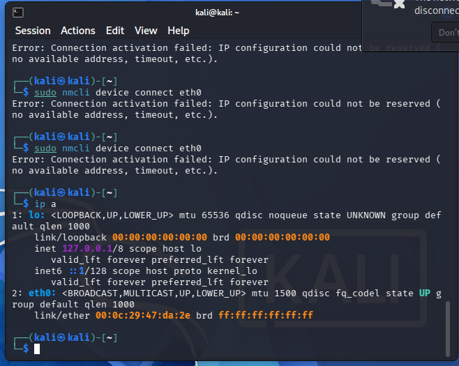
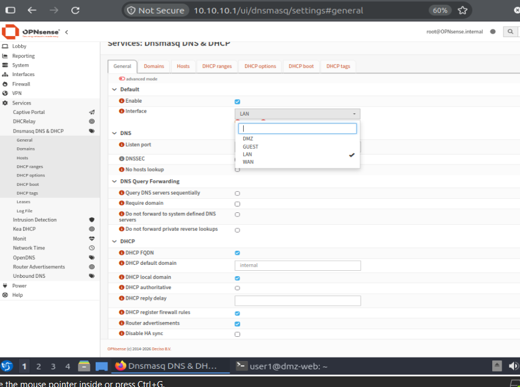
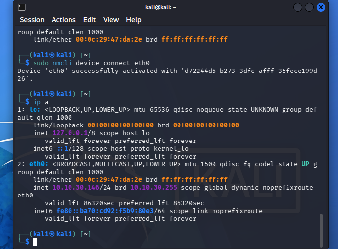

# 06. Troubleshooting

Problems met during the build, in the order they happened, with the cause and fix.

## Web server got a VMware NAT address instead of a DMZ address

**Symptom:** `ip a` on the web server showed `192.168.25.134`, a `dynamic` address in VMware's NAT range.
**Cause:** the VM's network adapter was on **NAT**, not the `DMZ` LAN Segment. VMware's DHCP answered it. That cannot happen on a LAN Segment.
**Fix:** shut the VM down, set the adapter to LAN Segment `DMZ`, then configured the static address.
**Lesson:** an address from the wrong range is the quickest sign that a VM is on the wrong network.

## netplan: Invalid YAML

**Symptom:** `sudo netplan apply` printed `Invalid YAML: did not find expected ',' or '}'` with a caret pointing at the problem.
**Cause:** three typing errors in a hand-typed line, because the server console does not support copy and paste: `netowrk:` instead of `network:`, a stray period in `10.10.20.10./24`, and `}].` instead of `}],`.
**Fix:** retyped the line, verified it with `sudo cat /etc/netplan/50-cloud-init.yaml` before applying, and moved a second installer-generated netplan file out of the way so the two would not merge.
**Lesson:** read the file before you apply it. After this, I administered the server over SSH from the LAN client, where pasting works.

## `apt` fails in the DMZ: "Temporary failure resolving"

**Symptom:** `sudo apt update` on the web server could not resolve any name.
**Cause:** an interface with no rules denies everything, including DNS to the firewall.
**Fix:** a temporary allow-all rule to get nginx installed, then replaced with the real rule set (DNS, block to `Internal_Zones`, web ports out) before running any tests.
**Lesson:** a temporary rule must be removed before testing. Tests run with it in place would not mean anything.

## Kali gets no IP address

**Symptom:** `eth0` was up with only an IPv6 link-local address. NetworkManager logged `dhcp4 ... no lease`, and `nmcli device connect eth0` failed with "IP configuration could not be reserved".

**Diagnosis:** the firewall's Live View filtered on the GUEST interface showed Kali's DHCP request (UDP `0.0.0.0:68` to `255.255.255.255:67`) arriving and being blocked as "Default deny". That also proved Kali was on the correct segment.

I then added a manual rule on GUEST to pass DHCP, but the real cause was elsewhere. On the Dnsmasq settings page, the **Interface** list contained only **LAN**, so the DHCP service was not listening on the GUEST port at all. The DHCP range I had created only defines what to hand out; the interface list defines where.

**Fix:** tick GUEST in the Dnsmasq interface list, then save and restart the service. Kali then received `10.10.30.146/24`.

**Cleanup:** once Dnsmasq listened on GUEST, OPNsense generated its own DHCP pass rules ("allow access to DHCP server" in the log), so the manual rule was redundant and was deleted. The final config has no manual DHCP rule.
**Lesson:** a DHCP range and a firewall rule are not enough. The service must also be listening on the interface. When a client gets no lease, check the service's interface list first, then the firewall log.

## OPNsense console: LAGG prompt

**Symptom:** the interface assignment wizard asked "configure LAGGs now?" and I answered yes.
**Fix:** press Enter on the empty member list to skip it, then answer `n` to VLANs.

## Package with no installation candidate

**Symptom:** `apt install` of a package list failed with `Package 'apt-listbugs' has no installation candidate`, and **none** of the other packages were installed.
**Cause:** apt aborts the whole command if one package cannot be found, and `apt-listbugs` is not available in this Ubuntu release.
**Fix:** removed it from the list and reran. The matching Lynis suggestion stays open.

## Lynis seemed stuck

**Symptom:** the scan paused at the plugins phase with a half-drawn status line.
**Cause:** the Debian plugin takes a few minutes on a small VM. Lynis also waits for a keypress between sections.
**Fix:** waited, then used `--quick`, which skips the keypress pauses.
